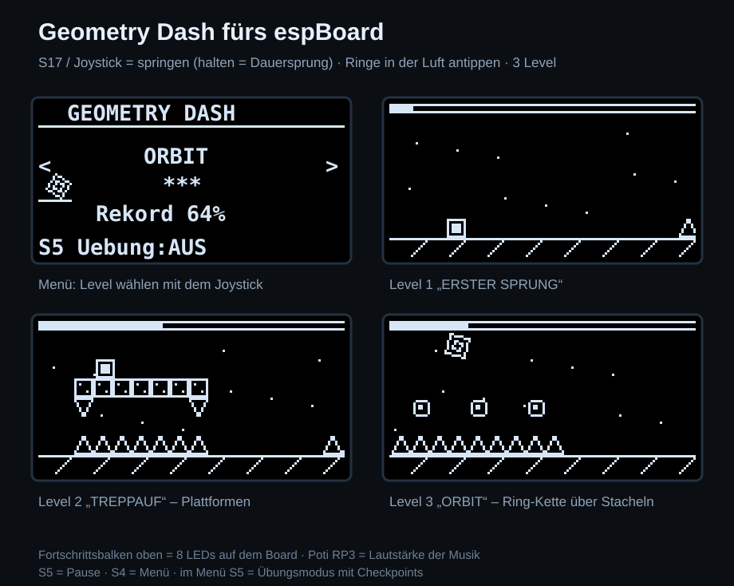

# Geometry Dash für das BZTG espBoard

Fan-Nachbau des bekannten Rhythmus-Springspiels (kein offizielles Spiel):
Der Würfel läuft von allein, du musst nur im richtigen Moment springen.
Ein Fehler, und es geht von vorne los.



## Dateien

| Datei | Zweck |
|---|---|
| `main.py` | Das Spiel mit 3 Leveln |
| `ssd1306.py` | Schneller OLED-Treiber |
| `vorschau.svg` | Vorschau (nur PC) |

Beide `.py`-Dateien in den **Root-Ordner** des ESP kopieren (Thonny:
*Speichern unter → MicroPython-Gerät*, oder
`mpremote connect COM3 cp main.py :main.py + cp ssd1306.py :ssd1306.py + reset`).

## Bedienung

| Eingabe | Menü | Im Spiel |
|---|---|---|
| Joystick links/rechts | Level wählen | – |
| **S16** / Joystick-Taster | Start | – |
| **S17** / Joystick-Taster / Joystick hoch | – | **Springen** (gedrückt halten = bei jeder Landung sofort wieder springen) |
| **S5** | Übungsmodus an/aus | Pause |
| **S4** | – | Zurück ins Menü |
| Poti **RP3** (links oben) | Lautstärke von Musik und Effekten, ganz links = stumm | |

Anzeigen: Balken oben im OLED **und die 8 LEDs** = Fortschritt im Level,
RGB-LED in der Levelfarbe, **rot** beim Absturz, kurz **weiß** beim Ring-Sprung.
Der beste Fortschritt pro Level wird in `gd_rekord.txt` auf dem ESP gespeichert.

## Die Hindernisse

| Zeichen im Level | Bild | Bedeutung |
|---|---|---|
| `#` | Block | Darauf kann man landen und laufen. Von der Seite oder von unten = Absturz |
| `^` | Stachel | Berühren = Absturz |
| `v` | Stachel nach unten | Hängt unter Blöcken |
| `o` | Sprungpad | Schleudert dich automatisch hoch |
| `*` | Sprungring | In der Luft im Ring **tippen** → zweiter Sprung |

## Level

| Level | Schwierigkeit | Länge | Neu |
|---|---|---|---|
| ERSTER SPRUNG | ★ | 26 s | Stacheln, Blöcke, Treppe, Sprungpad |
| TREPPAUF | ★★ | 23 s | Dreifach-Stacheln, Plattformen mit hängenden Stacheln, Ring |
| ORBIT | ★★★ | 23 s | Ring-Ketten über langen Stachelreihen, Treppe über Stacheln |

Alle Level wurden am PC von einem Bot durchgespielt, der dieselbe Physik
benutzt – sie sind also garantiert schaffbar.

**Übungsmodus:** Alle 3 Sekunden wird automatisch ein Checkpoint gesetzt
(kleines Dreieck am Boden). Nach einem Absturz geht es dort weiter.
Übungs-Runden zählen nicht für den Rekord.

## Eigene Level bauen

Ein Level ist eine Liste von Abschnitten. Jeder Abschnitt ist ein kleines Bild
aus 6 Zeilen; die unterste Zeile liegt auf dem Boden:

```python
("..............",
 "..............",
 "..............",
 "....###.......",
 "....###.......",
 "..o.###.......",),
```

Einfach in `LEVELS` einen neuen Eintrag `("NAME", sterne, 0, (abschnitte...))`
anlegen. Hilfen: `leer(n)` = n leere Spalten, `boden("..^^..")` = nur die
Bodenzeile. Zur Orientierung: Ein normaler Sprung ist ca. **2,9 Blöcke hoch und
4 Blöcke weit**, drei Stacheln hintereinander sind das Maximum.

## Einstellungen (oben in `main.py`)

| Konstante | Standard | Bedeutung |
|---|---|---|
| `TEMPO` | 60 | Laufgeschwindigkeit in Pixel/s |
| `SPRUNG` / `SCHWERKRAFT` | 185 / 720 | Sprungkraft und Fallgeschwindigkeit |
| `PAD_SPRUNG` / `ORB_SPRUNG` | 235 / 175 | Sprungpad und Ring |
| `MUSIK` | True | Hintergrundmusik über den Piezo |
| `MAX_FPS` | 60 | Obergrenze der Bildrate |
| `I2C_FREQ` | 400000 | OLED-Takt; mit 800000–1000000 läuft es flüssiger, wenn das Display mitmacht |
| `LED_PINS` | 13 … 32 | LEDs von links (P7) nach rechts (P0) |

Die Physik rechnet immer in festen Schritten von 1/120 s. Deshalb springt der
Würfel bei jeder Bildrate gleich weit. Wer an `TEMPO` oder `SPRUNG` dreht,
muss die Level eventuell anpassen.

> Musik braucht die gesteckte Brücke **XJ15** (Summer).

Mehr zum Board: [`docs/espBoard.md`](../docs/espBoard.md)
