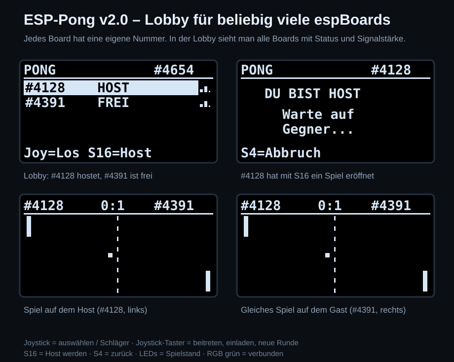

# ESP32-Programme für das BZTG espBoard

MicroPython-Programme für das **espBoard** (ESP32-WROOM-32, OLED 128×64,
Joystick, Taster, Potis, LEDs, RGB-LED, Summer, BMP280) vom BZTG Oldenburg.

| Ordner | Programm | Kurz |
|---|---|---|
| [`Hub/`](Hub/) | **ESP-Hub** *(neu)* | Spiele-Galerie: alle Spiele als `gal_*.py` aufs Board, in der Galerie auswählen, mit S4 + S5 zurück. Jedes Spiel läuft in einer Sandbox |
| [`ESP-Pong/`](ESP-Pong/) | **ESP-Pong v2.0** | Multiplayer-Pong über ESP-NOW mit Lobby: alle Boards im Raum sehen sich, jedes Board hat eine eigene Nummer, Host wählen oder einladen |
| [`Space-Dodge/`](Space-Dodge/) | **Space Dodge v2.0** | Weltraum-Shooter mit Schild, Bombe, Munitions-LEDs und Bestenliste |
| [`Geometry-Dash/`](Geometry-Dash/) | **Geometry Dash** *(neu)* | Würfel-Springspiel mit 3 Leveln, Ringen, Sprungpads, Übungsmodus und Musik |
| [`3D-Render/`](3D-Render/) | **3D-Render v2.0** | Drahtgitter-Körper (Würfel bis Ikosaeder) mit dem Joystick drehen |
| [`simulator/`](simulator/) | **espBoard-Simulator** *(neu)* | Das Board im Browser: lädt die Ordner aus GitHub und führt `main.py` mit echtem MicroPython aus – auch zwei Boards per ESP-NOW |
| [`docs/espBoard.md`](docs/espBoard.md) | **Board-Doku** | Bauteile, Pinbelegung, Messprotokoll mit Sollwerten, Stromversorgung |



## Im Browser ausprobieren

**<https://mailo037.github.io/ESP32-Programme/>** – der Simulator lädt alle Programme
direkt aus diesem Repo (Branch `main`) und lässt sie auf einem nachgebauten
espBoard laufen. Einmalig nötig: *Settings → Pages → Deploy from a branch →
main / (root)*. Details: [`simulator/README.md`](simulator/README.md).

## Schnellstart

**Alle Spiele auf einmal (empfohlen):** Mit dem [Hub](Hub/) startet das Board
mit einer Galerie, und das ständige Austauschen von `main.py` entfällt:

```powershell
pip install mpremote
python Hub/installieren.py COM3
```

**Einzelnes Programm:**

1. [Thonny](https://thonny.org) installieren, MicroPython (v1.2x) auf den ESP32 flashen.
2. Ordner des gewünschten Programms öffnen.
3. `main.py` **und** `ssd1306.py` in den **Root-Ordner** des ESP speichern
   (Thonny: *Datei → Speichern unter → MicroPython-Gerät*).
4. Board neu starten. Beim Start den Joystick loslassen (Kalibrierung).

Mit `mpremote`:

```powershell
cd ESP-Pong
mpremote connect COM3 cp main.py :main.py + cp ssd1306.py :ssd1306.py + reset
```

**Herunterladen:** Auf GitHub *Code → Download ZIP* lädt alles auf einmal.

## Was ist neu in v2.0?

- **Gemeinsamer, schnellerer OLED-Treiber** (`ssd1306.py`, in jedem Ordner gleich):
  Adressbefehle in einer einzigen I²C-Übertragung und neu `show_rect()`, das nur
  einen Bildausschnitt überträgt. Kompatibel zum Original-Treiber.
- **ESP-Pong:** Lobby für beliebig viele Boards, Board-Nummern, Host-Auswahl und
  Einladungen, Teil-Updates des Displays, Ball-Vorhersage beim Gast → deutlich flüssiger.
- **Space Dodge:** gleiches Spieltempo bei jeder Bildrate, BMP280 ohne Zusatzdatei,
  kleinere Fehler behoben.
- **3D-Render:** mehr FPS, zwei neue Körper, LEDs zeigen die Form.

Details stehen in den READMEs der einzelnen Ordner.
